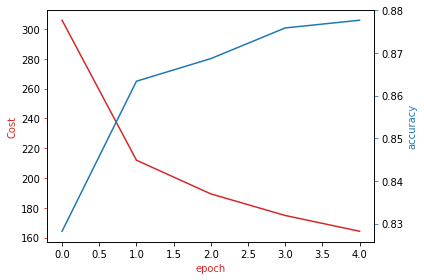

# Deep Neural Networks me PyTorch

[](https://deep-neural-networks.netlify.app/)


**Platformë mësimore në shqip dhe kodi i plotë i kursit "Deep Neural Networks with PyTorch".**
Nga tensorët e parë deri te një CNN për FashionMNIST, në 7 module me teori, ushtrime kodimi, flashcards, provime dhe progres të ruajtur.

> **English summary:** An Albanian-language, static learning platform plus the complete Python code for the Coursera course *Deep Neural Networks with PyTorch* (7 weeks: tensors and autograd, linear/logistic regression, softmax, deep networks and regularization, CNNs, and a FashionMNIST project). Pure HTML, CSS and JavaScript, deployable on Netlify with no build step.

## Platforma live

**https://deep-neural-networks.netlify.app/**

Hyrja kërkon fjalëkalim. Kërkoji autorit të repository-t për qasje.

## Çfarë përmban ky repository

| Pjesa | Përshkrimi |
|---|---|
| [`platform/`](platform) | Faqja statike mësimore (HTML, CSS, JavaScript), pa backend dhe pa build. |
| [`course-code/`](course-code) | 38 skedarë Python të kursit, të organizuar sipas javëve. |
| [`assets/`](assets) | Imazhe për dokumentacionin. |

## Programi i kursit

| Java | Tema | Çfarë mëson |
|---|---|---|
| 1 | Tensorët dhe diferencimi automatik | Tensorët 1D dhe 2D, llojet e të dhënave, `requires_grad` dhe `backward()`. |
| 2 | Regresioni linear dhe SGD | Humbja MSE, zbritja e gradientit, mini-batch, `Dataset`, `DataLoader`, `torch.optim`, ndarja trajnim/validim. |
| 3 | Regresioni i shumëfishtë dhe logjistik | `nn.Linear` me shumë hyrje dhe dalje, sigmoid, entropia e kryqëzuar, inicializimi i keq. |
| 4 | Softmax dhe rrjetet me shtresë të fshehur | Klasifikimi me shumë klasa në MNIST, aktivizimet (sigmoid, tanh, ReLU), më shumë neurone të fshehura. |
| 5 | Rrjete të thella dhe rregullimi | `nn.ModuleList`, inicializimi (Uniform, Xavier, He), dropout, momentum, batch normalization. |
| 6 | Rrjetet konvolucionale (CNN) | Konvolucioni, kanale të shumta, max pooling, CNN me dhe pa BatchNorm në MNIST. |
| 7 | Projekti: FashionMNIST | CNN me dy shtresa konvolucionale, trajnim me `DataLoader`, kosto dhe saktësi për epokë. |

## Platforma mësimore

- **7 module** me teori në shqipe, terma kyç dhe formula.
- **Praktiko veten:** ushtrime teorike dhe me kod PyTorch. Shkruan zgjidhjen, e kontrollon dhe e krahason me zgjidhjen e saktë.
- **Kodi i kursit:** të gjithë skedarët Python të çdo jave, të hapshëm direkt në faqe.
- **Flashcards** dhe **fjalor teknik** me kërkim.
- **Provime** për çdo modul dhe provim final.
- **Progres** i ruajtur në shfletues (`localStorage`).
- **Hyrje me fjalëkalim** para se të hapet platforma.
- Dizajn responsiv, punon edhe në celular.

## Rezultati i projektit (Java 7)

CNN-ja e trajnuar në FashionMNIST për 5 epoka (SGD, `lr = 0.1`, `batch_size = 100`): kostoja bie vazhdimisht, ndërsa saktësia në validim rritet nga rreth 83% në rreth 88%.



## Struktura

```
.
├── README.md
├── assets/
│   └── week7-cost-accuracy.png
├── course-code/
│   ├── Week 1/   tensorët
│   ├── Week 2/   regresioni linear, SGD
│   ├── Week 3/   regresioni i shumëfishtë dhe logjistik
│   ├── Week 4/   softmax, rrjete me shtresë të fshehur
│   ├── Week 5/   rrjete të thella, dropout, BatchNorm
│   ├── Week 6/   CNN
│   └── Week 7/   projekti FashionMNIST
└── platform/
    ├── index.html
    ├── css/style.css
    └── js/
        ├── data.js    modulet, pyetjet, ushtrimet
        ├── code.js    kodi i kursit për faqen
        ├── app.js     logjika e platformës
        └── gate.js    ekrani i hyrjes
```

## Ekzekutimi lokal

**Platforma** (nuk kërkon instalim):

```bash
cd platform
python -m http.server 8000
# hap http://localhost:8000
```

**Kodi Python:**

```bash
pip install torch torchvision matplotlib numpy pandas
python "course-code/Week 2/Simple Linear Regression.py"
```

Skedarët janë shkruar për t'u ekzekutuar pjesë-pjesë në Jupyter ose Google Colab. Disa shkarkojnë MNIST ose FashionMNIST herën e parë që ekzekutohen.

## Publikimi në Netlify

1. Në Netlify zgjidh **Add new site**, pastaj **Deploy manually** (ose lidh këtë repository me *Base directory* `platform`).
2. Tërhiq folderin `platform`. Nuk ka komandë build.

## Shënim për fjalëkalimin

Porta e hyrjes është e anës së klientit (fjalëkalimi ruhet si hash në `platform/js/gate.js`). Mjafton për të mbajtur larg vizitorët e rastit, por nuk është mbrojtje e plotë, sepse faqja është statike. Për mbrojtje reale përdor mbrojtjen me fjalëkalim të Netlify ose një funksion serveri.

## Kredite

Kodi i kursit është zbatim i materialit të kursit [Deep Neural Networks with PyTorch](https://www.coursera.org/learn/deep-neural-networks-with-pytorch) në Coursera. Platforma mësimore dhe përmbajtja në shqip janë ndërtuar për studim personal.

## Licenca

Zgjidh një licencë për repository-n (p.sh. MIT) dhe shtoje si `LICENSE`.
